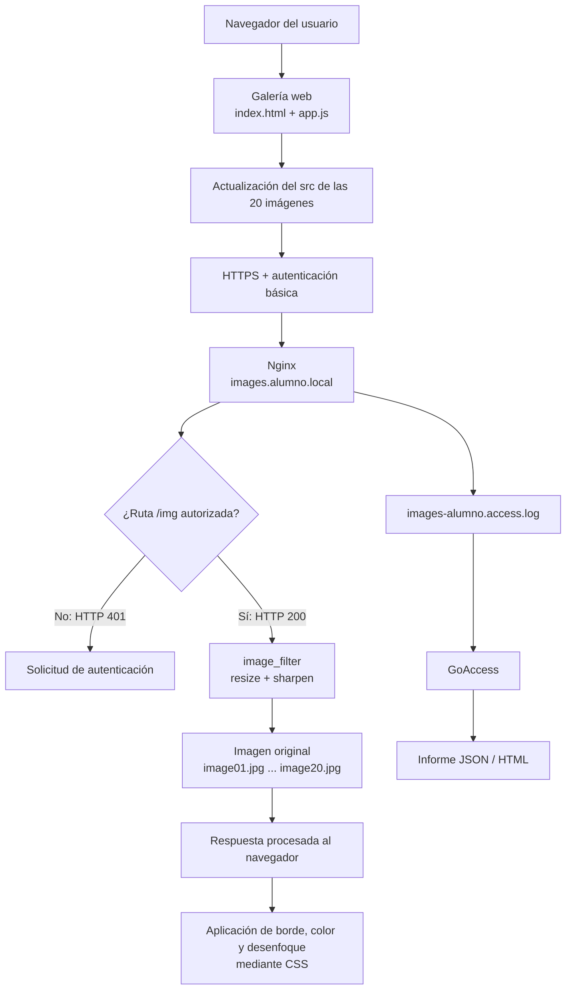

# AE3 — Galería con procesado de imágenes, módulos y HTTPS

## Objetivo

Desplegar una galería web en images.alumno.local utilizando Nginx, el módulo `image_filter`, HTTPS con certificado autofirmado, autenticación básica y análisis de logs con GoAccess.

## Instalación y activación del módulo `image_filter`

La práctica se realiza dentro del contenedor Docker `dpl-lab`, que
dispone de Nginx. El módulo `image_filter` permite redimensionar y
procesar imágenes cuando Nginx las sirve, sin generar miniaturas
intermedias.

### Instalación

Actualizar los índices de paquetes e instalar el módulo:

```bash
docker exec dpl-lab apt-get update
docker exec dpl-lab apt-get install -y libnginx-mod-http-image-filter
```

### Activación

En Ubuntu, la instalación del paquete habilita el módulo dinámico
mediante un archivo en `/etc/nginx/modules-enabled/`.

Comprobar que existe:

```bash
docker exec dpl-lab ls -l /etc/nginx/modules-enabled/
```

### Validación

Comprobar que Nginx acepta su configuración:

```bash
docker exec dpl-lab nginx -t
```

### Confirmar que Nginx reconoce el módulo

```bash
docker exec dpl-lab nginx -V 2>&1 | grep image_filter
docker exec dpl-lab nginx -T 2>&1 | grep -E "load_module|image_filter"
```

## Generación de imágenes de prueba

Las 20 imágenes originales se generan dentro del contenedor `dpl-lab`
con ImageMagick. Todas tienen dimensiones de 400x400 píxeles y nombres
desde `image01.jpg` hasta `image20.jpg`.

Comando utilizado:

```bash
docker exec dpl-lab bash -c 'for i in $(seq -w 1 20); do convert -size 400x400 gradient:"#2f6fed"-"#8bc34a" -fill white -pointsize 64 -gravity center -annotate 0 "IMG $i" "/var/www/images.alumno.local/img/image$i.jpg"; done'
```

Comprueba la primera imagen:

```bash
docker exec dpl-lab identify /var/www/images.alumno.local/img/image01.jpg
```

## Crear la aplicación de la galería

La aplicación web está formada por tres archivos:

- `web/index.html`: contiene el formulario con los cinco controles y el contenedor de la galería.
- `web/app.js`: crea las 20 imágenes y actualiza sus URL cuando el usuario pulsa el botón «Generar».
- `web/estilos.css`: define la presentación de la galería.

El formulario permite modificar el tamaño de las imágenes, el ancho del borde, su color, el enfoque y el desenfoque.

### Procesamiento de imágenes

La aplicación distribuye el trabajo entre el servidor y el cliente:

- **Servidor (Nginx):** procesa el redimensionado y el enfoque mediante el módulo `image_filter`. Los valores se envían en los parámetros `size` y `sharpen` de la URL.
- **Cliente (navegador):** aplica el ancho y el color del borde mediante CSS, así como el desenfoque con `filter: blur()`.

### Copiar la aplicación al DocumentRoot

Los archivos de la aplicación deben estar disponibles en el directorio servido por Nginx:

```bash
docker exec dpl-lab cp /home/alumno/dpl/ae3/web/index.html /var/www/images.alumno.local/
docker exec dpl-lab cp /home/alumno/dpl/ae3/web/app.js /var/www/images.alumno.local/
docker exec dpl-lab cp /home/alumno/dpl/ae3/web/estilos.css /var/www/images.alumno.local/
docker exec dpl-lab chmod -R a+rX /var/www/images.alumno.local
```

## Generar el certificado HTTPS

Para proteger la galería se utiliza un certificado autofirmado generado
con OpenSSL dentro del contenedor Docker `dpl-lab`.

El certificado se utiliza para el sitio `images.alumno.local` y contiene
también el nombre alternativo `www.images.alumno.local` mediante la
extensión SAN (Subject Alternative Name).

### Generación del certificado

Primero se crea el directorio destinado a los certificados:

```bash
docker exec dpl-lab mkdir -p /etc/ssl/dpl
```

A continuación, se genera el certificado autofirmado y su clave privada:

```bash
docker exec dpl-lab openssl req -x509 -nodes -newkey rsa:2048 -days 365 -keyout /etc/ssl/dpl/images.alumno.local.key -out /etc/ssl/dpl/images.alumno.local.crt -subj "/CN=images.alumno.local" -addext "subjectAltName=DNS:images.alumno.local,DNS:www.images.alumno.local"
```

La clave privada se protege con permisos restrictivos:

```bash
docker exec dpl-lab chmod 400 /etc/ssl/dpl/images.alumno.local.key
```

### Verificación

Se comprueban el sujeto, la validez y los nombres DNS del certificado:

```bash
docker exec dpl-lab openssl x509 -in /etc/ssl/dpl/images.alumno.local.crt -noout -subject -dates -ext subjectAltName
```

### Certificado público y clave privada

El certificado público se copia al directorio `certs/` del proyecto:

```bash
docker cp dpl-lab:/etc/ssl/dpl/images.alumno.local.crt ~/dpl/ae3/certs/images.alumno.local.crt
```

El archivo `certs/LEEME.md` contiene las instrucciones para generar el certificado.

La clave privada permanece en `/etc/ssl/dpl/` dentro del contenedor y no se incluye en el repositorio Git.

Al ser autofirmado, el navegador puede mostrar una advertencia de confianza.

## Configurar la autenticación básica

La galería utiliza la autenticación HTTP Basic para proteger el acceso a las imágenes. Las credenciales son el usuario y la contraseña.

### Crear el fichero de usuarios

Se genera el hash de la contraseña con OpenSSL y se guarda fuera del DocumentRoot, en `/etc/nginx/htpasswd-images`:

```bash
docker exec dpl-lab bash -c 'echo "alumno:$(openssl passwd -apr1 CONTRASEÑA)" > /etc/nginx/htpasswd-images'
```

### Proteger el fichero

Se asignan el propietario y el grupo necesarios para que Nginx pueda
leer el fichero:

```bash
docker exec dpl-lab chown root:www-data /etc/nginx/htpasswd-images
docker exec dpl-lab chmod 640 /etc/nginx/htpasswd-images
```

### Comprobación

```bash
docker exec dpl-lab ls -l /etc/nginx/htpasswd-images
docker exec dpl-lab cat /etc/nginx/htpasswd-images
```

El fichero contiene el usuario y el hash de su contraseña, no la
contraseña en texto plano.

## Configuración del sitio en Nginx

Se ha creado el archivo de configuración `/etc/nginx/sites-available/004-images.alumno.local` dentro del contenedor `dpl-lab`.

### Bloques map

Se han definido tres directivas `map` para controlar los parámetros que recibe la aplicación mediante la URL:

- `$img_size`: permite los tamaños 150, 300 y 600 píxeles. El valor predeterminado es 300.
- `$img_quality`: permite las calidades JPEG 60, 80 y 100. El valor predeterminado es 80.
- `$img_sharpen`: permite los niveles de enfoque 0, 30, 60 y 100. El valor predeterminado es 0.

Estas listas blancas evitan que se utilicen valores arbitrarios
en los parámetros de procesamiento de imágenes.

Las directivas `map` se declaran en el contexto `http`, fuera de los bloques `server`, porque Nginx no permite definirlas dentro de un servidor o una ubicación.

### Servidor HTTPS

El bloque principal configura el sitio `images.alumno.local`:

- Escucha las conexiones HTTPS por el puerto 443.
- Utiliza `/var/www/images.alumno.local` como DocumentRoot.
- Define `index.html` como página de inicio.
- Utiliza el certificado y la clave privada configurados para el sitio.

La ubicación `/` sirve los archivos de la aplicación y utiliza `try_files` para comprobar que los recursos solicitados existen.

### Procesamiento y autenticación de imágenes

La ubicación `/img/` contiene las directivas de procesamiento del módulo `image_filter`:

- `image_filter resize`: redimensiona las imágenes utilizando el tamaño permitido.
- `image_filter_sharpen`: aplica el nivel de enfoque solicitado.
- `image_filter_jpeg_quality`: establece la calidad JPEG.
- `image_filter_buffer 5M`: establece un búfer máximo de 5 MB para leer las imágenes.

Esta ubicación también utiliza autenticación básica mediante `auth_basic` y el archivo de usuarios `/etc/nginx/htpasswd-images`.

La directiva `error_page 401 @sin_autorizacion` permite gestionar la respuesta de autenticación sin que el filtro de imágenes transforme la respuesta de error. La ubicación con nombre `@sin_autorizacion` devuelve el código HTTP 401.

### Redirecciones

Se han definido dos bloques adicionales:

- Las peticiones HTTP a `images.alumno.local` se redirigen a HTTPS.
- Las peticiones HTTP a `www.images.alumno.local` se redirigen al dominio `https://images.alumno.local`.

### Registros

Se han configurado archivos específicos para registrar la actividad del sitio:

- `/var/log/nginx/images-alumno.access.log`
- `/var/log/nginx/images-alumno.error.log`

### Comprobación de la configuración

Antes de activar el sitio, se ha comprobado la sintaxis de Nginx:

```bash
docker exec dpl-lab nginx -t
```

## Activación y validación del sitio

Se activa el sitio creando un enlace simbólico desde `sites-available` hacia `sites-enabled`.

```bash
docker exec dpl-lab ln -s /etc/nginx/sites-available/004-images.alumno.local /etc/nginx/sites-enabled/
```

Se comprueba la sintaxis de Nginx mediante `nginx -t` y, si la validación es correcta, se recarga el servicio para aplicar los cambios.

Finalmente, se verifica la configuración cargada mediante `nginx -T`:

```bash
docker exec dpl-lab nginx -T | grep -E "server_name images|image_filter|load_module" | head
```

Salida:

```text
load_module modules/ngx_http_image_filter_module.so;
    server_name images.alumno.local;
        # Sin esto, image_filter convierte la pagina de error del 401 en un
        image_filter resize $img_size $img_size;
        image_filter_sharpen $img_sharpen;
        image_filter_jpeg_quality $img_quality;
        image_filter_buffer 5M;
    # Respuesta de autenticacion sin image_filter de por medio
    server_name images.alumno.local;
```

## Diagrama de funcionamiento

El siguiente diagrama muestra el funcionamiento de la galería, desde el navegador hasta el servidor Nginx, incluyendo el procesamiento de imágenes, la autenticación y el registro de actividad.



## Pruebas de funcionamiento del sitio

Las pruebas se realizaron desde el contenedor `dpl-lab`, utilizando `curl` para comprobar las respuestas HTTP y HTTPS.

### Acceso a la galería

Se comprobó el acceso HTTPS a la página principal:

```bash
docker exec dpl-lab curl -k -I https://localhost/ -H "Host: images.alumno.local"
```

Resultado: `200 OK`.

### Autenticación básica

Se solicitó una imagen sin proporcionar credenciales:

```bash
docker exec dpl-lab curl -k -I "https://localhost/img/image01.jpg" -H "Host: images.alumno.local"
```

Resultado: `401 Unauthorized`.

### Procesamiento de imágenes

Se descargó una imagen con autenticación y un tamaño solicitado de 150 píxeles:

```bash
docker exec dpl-lab curl -k -u USUARIO:CONTRASENA -o /tmp/mini.jpg \
    "https://localhost/img/image01.jpg?size=150&q=60&sharpen=30" -H "Host: images.alumno.local"
```

Se verificaron las dimensiones con ImageMagick:

```bash
docker exec dpl-lab identify /tmp/mini.jpg
```

Resultado: imagen JPEG de 150x150 píxeles.

```text
/tmp/mini.jpg JPEG 150x150 150x150+0+0 8-bit sRGB 1938B 0.000u 0:00.000
```

También se solicitó un tamaño de 600x600. Como la imagen original
mide 400x400 píxeles, el resultado mantuvo las dimensiones originales.

### Redirecciones HTTP a HTTPS

Se comprobó la redirección del dominio principal:

```bash
docker exec dpl-lab curl -I http://localhost/ -H "Host: images.alumno.local"
```

Resultado: 

`301 Moved Permanently` con destino `https://images.alumno.local/`.

También se comprobó la redirección del subdominio `www`:

```bash
docker exec dpl-lab curl -I http://localhost/ -H "Host: www.images.alumno.local"
```

Resultado:

```text
HTTP/1.1 301 Moved Permanently
Server: nginx/1.24.0 (Ubuntu)
Date: Sun, 11 Oct 2026 16:49:40 GMT
Content-Type: text/html
Content-Length: 178
Connection: keep-alive
Location: https://images.alumno.local/
```

### Certificado HTTPS

Se examinó el certificado presentado por el servidor:

```bash
docker exec dpl-lab openssl s_client -connect localhost:443 -servername images.alumno.local 2>&1 | grep -E "subject=|issuer="
```

Salida:

```text
subject=CN = images.alumno.local
issuer=CN = images.alumno.local
```

## Análisis de registros con GoAccess

### Instalación

Se ha instalado GoAccess en el contenedor Docker `dpl-lab` para analizar las peticiones recibidas por el servidor web Nginx.

```bash
docker exec dpl-lab apt-get update
docker exec dpl-lab apt-get install -y goaccess
```

Se puede comprobar la instalación mediante:

```bash
docker exec dpl-lab goaccess --version
```

### Generación de informes

Se utiliza el registro de acceso específico del sitio `images.alumno.local` y se generan dos informes con el formato de registro `COMBINED`:

```bash
docker exec dpl-lab goaccess /var/log/nginx/images-alumno.access.log --log-format=COMBINED -o /home/alumno/dpl/informe-images.json

docker exec dpl-lab goaccess /var/log/nginx/images-alumno.access.log --log-format=COMBINED -o /home/alumno/dpl/informe-images.html
```

Los informes se guardan en `/home/alumno/dpl/` dentro del contenedor. Este directorio está compartido con `/home/aperez/dpl/` en la máquina virtual, por lo que los archivos también están disponibles en `~/dpl/`.

### Comprobación de los informes

Se comprueba el registro de acceso y la generación de los informes:

```bash
docker exec dpl-lab tail -n 10 /var/log/nginx/images-alumno.access.log
```

GoAccess permite analizar las peticiones recibidas, las rutas solicitadas y los códigos de respuesta HTTP registrados.

Durante las pruebas del sitio se han generado peticiones con respuestas satisfactorias (200), redirecciones (301) y solicitudes sin autenticar (401).

## Copia de la configuración de Nginx al repositorio

Para conservar una copia de la configuración del sitio y facilitar su revisión, se ha copiado el archivo de configuración desde el contenedor Docker al repositorio de la práctica.

Comando utilizado:

```bash
docker cp dpl-lab:/etc/nginx/sites-available/004-images.alumno.local ~/dpl/ae3/nginx/images.alumno.local.conf
```

La configuración se guarda en `nginx/images.alumno.local.conf`

Este archivo contiene la configuración del sitio virtual, incluidos los bloques de servidor, las redirecciones HTTP a HTTPS, las reglas de procesamiento de imágenes mediante `image_filter` y la autenticación básica aplicada al directorio `/img/`.

La copia versionada permite consultar la configuración utilizada sin tener que acceder directamente al contenedor.

## Comprobaciones finales

Se utilizan los siguientes comandos para verificar el funcionamiento de Nginx y del sitio:

```bash
docker exec dpl-lab nginx -t

docker exec dpl-lab nginx -T | grep -E 'loadmodule|imagefilter|auth_basic'

docker exec dpl-lab curl -k -I https://localhost/ -H "Host: images.alumno.local"

docker exec dpl-lab curl -k -I https://localhost/img/image01.jpg -H "Host: images.alumno.local"

docker exec dpl-lab identify /tmp/mini.jpg
```

## Repositorio remoto

El proyecto AE3 está alojado en GitHub. El repositorio contiene la configuración de Nginx, la aplicación web, el certificado público, las instrucciones de generación del certificado, las comprobaciones y la documentación de la práctica.

Repositorio: [AE3 en GitHub](https://github.com/apg-29/AE3-Galeria)
